# HEARTz UI 및 기능 정의서

- 기준 버전: HEARTz 0.1.0 (debug), applicationId `ai.heartz.app`
- 작성일: 2026-11-10, 개정 2026-11-11(화면 다듬기, 음악·내비·공감 흐름, 샘플 목소리), **2026-11-11 2차 개정(피드백 반영: 바로 읽기·대기열, 다시 녹음, 변조 목소리, 잡음 줄이기, 나만 보기 삭제, 분위기 삭제·임의 색, "편지"→"사연", 탭 이름)**
- 그림: Pleos Connect 에뮬레이터(2560×1440)에서 내비 옆 분할 창에 띄운 HEARTz 창만 잘라낸 캡처. 위치·기어는 테스트 입력이고, "(시드 작성자)"가 보낸 사연은 합성 테스트 음원이다.
- **3차 개정(2026-11-12, v8 화면)**: 사용자 시안 `heartz_v8_screens.zip`(44장)대로 전체 화면을 다시 만들었다. 흰 바탕·검은 사연 카드·초록 강조, Pretendard 글꼴, 왼쪽 메뉴(Hz 표시·초록 알약), 프로필 얼굴 12종(앱이 직접 그린 그림)과 프로필 꾸미기 화면이 새로 생겼다. 동작은 아래 표 그대로다(시안의 분위기 칩·"모두에게/나만 듣기" 버튼은 지난 결정대로 넣지 않고, 색만·보내기/다시 녹음/목소리 선택으로 대체). 새 화면 캡처는 `images-v8/`(17장)에 있다.
- **화면 자료 정리(2026-11-12):** 아래 그림은 남아 있는 v8 캡처로 교체했다. 캡처가 없는 상태는 글로 설명하고, 개편 전 그림은 `images/`에 이력으로 보관한다. 캡처 17장 전체는 [화면 목록](#6-v8-캡처-목록)에서 볼 수 있다. 모든 상태를 캡처한 것은 아니다.
- **4차 개정(2026-11-12):** 기존 사람 얼굴을 사용자 호랑이 원본 기반 **12간지 동물**로 교체하고 닉네임 편집·최초 프로필 설정·약 1.4초 시작 화면을 추가했다. HEARTz의 H에만 그라데이션을 쓰며 Hz 표시와 런처 아이콘도 초록→흰색이다. 도착 카드에서는 합성 음원·변조 목소리 칩·색 표시를 빼고 **이 길에 남겨진 사연 / 장소 / 초수 / 보낸 이 동물·닉네임**만 보여 준다. 기존 v8 그림의 사람 얼굴·부가 칩은 이전 상태이며 최신 화면은 [7절](#7-12간지닉네임시작-화면-캡처)을 따른다.
- **5차 개정(2026-11-13):** 동물 프로필·프로필 꾸미기·최초 프로필 설정을 **없앴다.** 모든 프로필 자리는 Pleos Connect 상태 표시줄 모양(흰 원·회색 테두리·보라 닉네임 첫 글자)이다. 닉네임은 계정에 저장된 이름이다(Pleos 프로필 이름을 앱이 읽을 수 없어 연동은 향후 개발, HEARTZ-PLAN 3절). 장소는 서울 25개 구 랜드마크 236곳("구 동 랜드마크")이고, **랜드마크 반경 1 km 안에 들어오면** 사연이 도착한다. 목록은 "구 랜드마크", 상세·주행 카드는 랜드마크만 쓴다. 이번 개정에서 바뀐 것은 다음과 같다. 남기기 장소 검색이 생겼다. 주행 화면의 "말로 답해도 돼요" 같은 힌트와 "재생 중" 표시를 뺐다. 지나면서 남기기 녹음 화면은 남기기(주차) 녹음 화면과 같은 구성으로 바꿨다. 7절 이전 캡처의 동물 얼굴은 이전 상태다.

---

## 0. 한눈에 보기

HEARTz는 길 위의 장소에 남겨진 짧은 음성 사연을 지나가는 운전자에게 읽어 주는 차량용 앱이다. 운전자는 그 장소에 자기 사연을 목소리로 남길 수 있다.

### 0-1. 화면 구성

플랫폼 `CarUxRestrictions`의 주행 제한 여부에 따라 화면이 자동으로 바뀐다. 기어는 에뮬레이터 시험 입력이며 화면 전환의 직접 판정값은 아니다. 제한 상태를 알 수 없으면 주행 화면으로 처리한다.

| 모드 | 언제 | 보이는 화면 |
|---|---|---|
| 주행 중 | 기어 D 등 주행 제한이 걸린 상태 | 1-1 주행 화면, 1-2 지나면서 남기기 |
| 주차 중 | 기어 P, 주행 제한이 없는 상태 | 왼쪽 메뉴가 있는 화면(2-1~2-9) |

```
HEARTz
├─ 주행 중
│   ├─ 1-1 주행 화면 (기다림 → 도착 안내·바로 읽기 → 공감 질문 → (줄 선 사연 있으면 "이번에는…") → 기다림)
│   └─ 1-2 지나면서 남기기 (안내 → 녹음(말이 멈추면 자동 종료) → 전달/다시 녹음 질문 → 목소리 질문 → 결과)
└─ 주차 중 (왼쪽 메뉴)
    ├─ 2-1 지금 이 길
    ├─ 2-2 지나온 사연 ── 2-3 사연 상세 (공감 하트·신고·숨기기)
    ├─ 2-4 남기기 (장소 → 녹음·잡음 줄이기 → 들어보고 목소리 고르고 보내기 → 완료)
    ├─ 2-5 내 사연함 (보내지 못한 사연 포함)
    ├─ 2-6 검수 (운영자 계정에서만)
    └─ 2-7 설정 ─ 2-8 기술 진단(개발용) / 2-9 프로필 꾸미기
```

### 0-2. 사연을 남기는 두 가지 방법

| 방법 | 언제 | 장소 정하기 | 목소리 정하기 |
|---|---|---|---|
| 주차 중 남기기(2-4) | 주차 중 | 목록에서 고름 | 버튼(내 목소리 / 변조 목소리) |
| 지나면서 남기기(1-2) | 사연과 관련된 곳을 지나는 중 | **녹음을 시작한 곳**으로 자동 | 말(또는 큰 버튼)로 답함 |

공개 범위는 하나다: 보내면 **검수 중**, 승인되면 **공개**. 나만 보기는 없다.
목소리: **내 목소리**(기본, 잡음을 줄인 원본 녹음) 또는 **변조 목소리**(받아쓴 글을 안내 목소리로 읽어 줌. 원본 녹음은 작성자·운영자만 들음).

### 0-3. 입력과 출력

| 구분 | 종류 | 설명 |
|---|---|---|
| 입력 | 터치 | 화면 버튼·목록·메뉴 |
| 입력 | 차량 신호 | 주행 제한 상태, 차량 위치(Pleos FusedLocation) |
| 입력 | 말(앱이 물은 뒤) | 앱이 질문한 직후 6~7초 동안 Pleos STT로 듣는다. 호출어가 필요 없다 |
| 입력 | Gleo 음성 명령 | 운전자가 Gleo를 불러 말한 명령. 함수 3개(3-1) |
| 입력 | 마이크(녹음) | 주차 중 남기기, 지나면서 남기기 |
| 출력 | 화면 | 카드, 목록, 큰 버튼, 짧은 알림 |
| 출력 | 사연 음성 | 주행 중 바로 읽기를 켜 두면(기본) 도착 안내 뒤 바로 재생, 주차 중에는 고를 때만. 변조 목소리 사연은 받아쓴 글을 Pleos TTS로 읽는다 |
| 출력 | 안내 음성 | Pleos TTS(기기 내 엔진)로 하는 짧은 질문·결과 안내 |
| 출력 | Gleo 응답 | 앱이 Gleo에 돌려주는 결과(영어). Gleo가 이것으로 대답한다 |

### 0-4. 공통 규칙

- **주행 중에는 묻지 않고 바로 읽는다:** "OO에서 사연이 도착했어요. 읽어드릴게요." 뒤 재생(설정에서 끄면 카드와 버튼만).
- **읽는 중에 온 사연은 줄을 선다:** 공감 여부를 정하면 "이번에는 OO에서 사연이 도착했어요. 읽어드릴게요."로 이어 읽는다. 앞 사연을 닫은 지 10초 안에 온 사연도 "이번에는"으로 알린다.
- **한 사연은 한 계정에 한 번만 도착한다:** 이미 받은 사연, 내 사연, 숨긴 사람의 사연, 공개되지 않은 사연은 오지 않는다.
- **공감하면 "사연자님께 마음이 전달되었어요."** 줄 선 사연이 없으면 약 5초 뒤 대기 화면으로 돌아간다. 같은 장소에 있는 동안에는 다음 사연을 바로 띄우지 않는다.
- **남의 사연에 음성으로 답장할 수 없다:** 공감 하트만 남길 수 있다(서버도 답장 생성을 거절).
- **공개 전에는 항상 운영자 검수를 거친다.** 상태는 검수 중 / 공개(운영상 반려·숨김 있음).
- **답이 분명하지 않으면 공개하거나 지우지 않는다:** 전달 질문에 답이 없으면 기기 초안으로 보관한다. 목소리 질문에 답이 없으면 내 목소리로 보낸다.
- **음악은 사연을 알릴 때 멈추고, 공감 여부를 정한 2초 뒤 다시 나온다.** 줄 선 사연이 있으면 계속 멈춘 채 이어 간다(3-2).
- **목소리 하나:** 앱의 안내·질문, 샘플 사연, 변조 목소리 사연은 시스템에 설정된 Gleo 목소리로 나온다(3-3).
- **화면 색:** 분위기는 화면에서 뺐다. 사연마다 파랑·주황·노랑·초록 중 하나를 고정해 사연지·봉투에 쓴다(감정 분석·앰비언트 라이트는 후속, HEARTZ-PLAN 3절).

### 0-5. 앱 시작

앱을 새로 실행하면 검은 바탕에 HEARTz 글자가 약 1.4초 나타난다. **H만 초록에서 흰색으로 변하고 EARTz는 흰색**이다. 계정을 불러올 때까지 대기하며 오류면 다시 시도할 수 있다. 처음 실행해도 프로필 설정 화면 없이 바로 메인 화면으로 간다(5차 개정).

주행 도착 시험 명령은 [DRIVING-TEST.md](../DRIVING-TEST.md)에 있다.

---

## 1. 주행 중 화면

### 1-1. 주행 화면

| 기다리는 중 | 재생 중 | 공감 질문 | 하트 없이 닫기 |
|---|---|---|---|
| 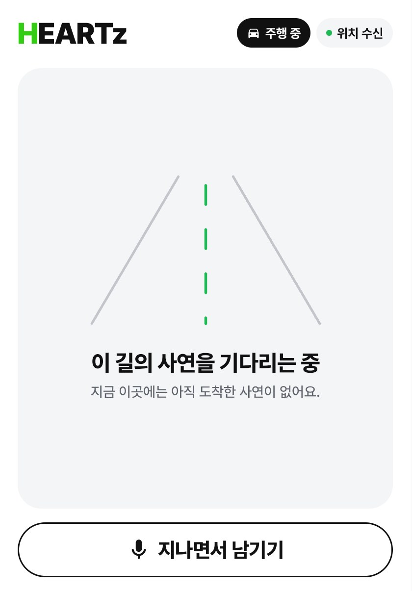 | 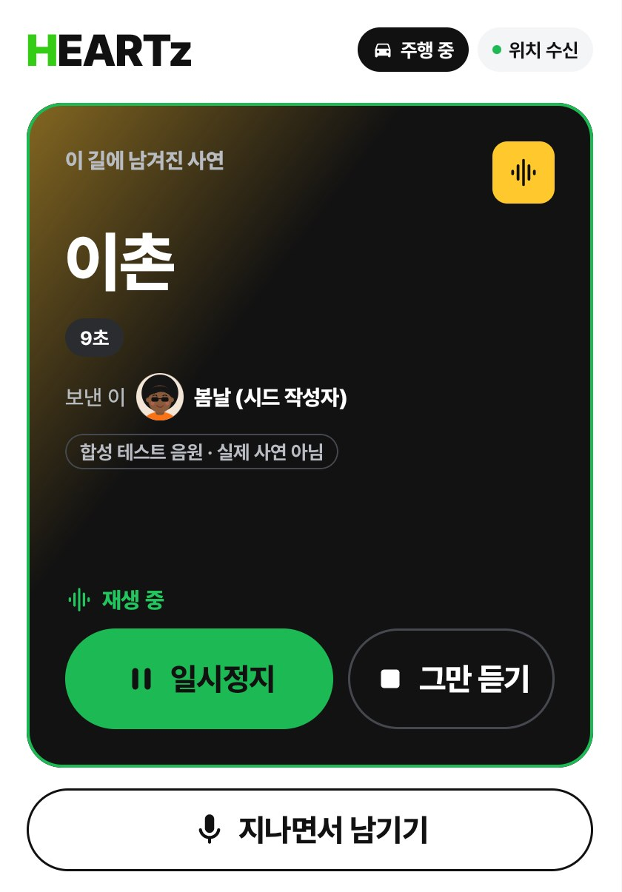 | 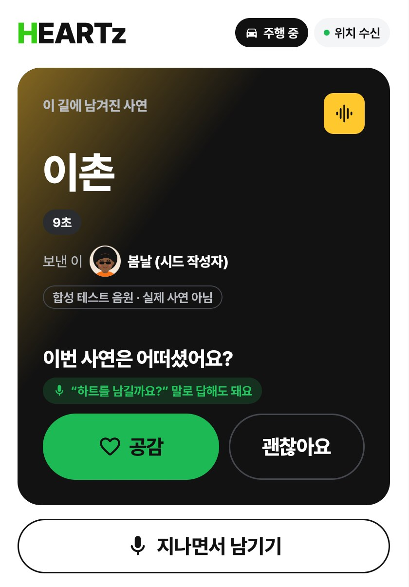 | 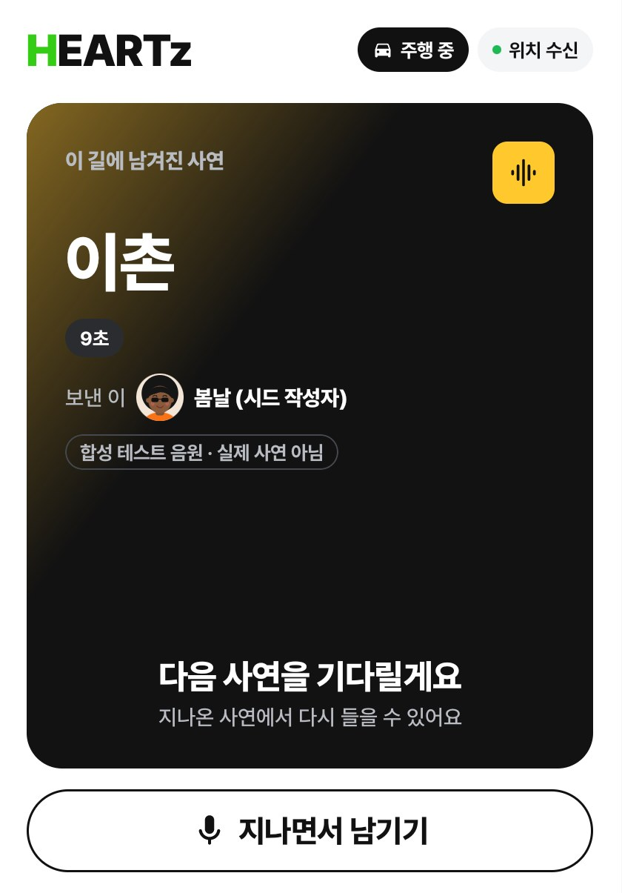 |

도착 안내·하트 남김 상태의 v8 캡처는 없다. 동작은 아래 표를 따른다.

**목적:** 운전 중에는 화면을 보거나 누르지 않고 사연을 듣고 공감하게 한다. 같은 동작을 큰 버튼과 Gleo로도 할 수 있다.

| 단계 | 입력 | 출력·결과 |
|---|---|---|
| 기다리는 중 | (차량 위치) | "이 길의 사연을 기다리는 중". 위치를 못 받을 때만 위에 "위치 확인 중" 등을 짧게 표시 |
| ① 도착 | (사연 랜드마크 반경 1 km 안에 들어옴) | 사연 정보: **이 길에 남겨진 사연 / 랜드마크 / 초수 / 보낸 이 첫 글자 원·닉네임**. 화면에 "말로 답해도 돼요" 같은 힌트와 "재생 중" 표시는 없다. 합성 음원·변조 목소리 칩·색 표시는 없음(카드 바탕의 사연 색은 유지). **음악을 멈추고**, 내비가 말하는 중이면 끝날 때까지 기다린 뒤 "OO에서 사연이 도착했어요. 읽어드릴게요." → **묻지 않고 바로 재생**. 안내 중에는 "곧 읽어드릴게요"와 **넘기기** 버튼 |
| ① 넘기기 | 버튼 **넘기기** / Gleo "넘겨" | "넘겼어요" 표시 후 약 1.5초 뒤 기다리는 중으로. 사연은 2-2 지나온 사연에 남는다 |
| ② 재생 중 | 버튼 일시정지 / 그만 | 다른 소리(통화·Gleo)가 끼어들면 잠시 멈췄다가 이어서 재생. "그만"이면 음악이 바로 다시 나온다. 변조 목소리 사연은 받아쓴 글을 문장 단위로 읽는다 |
| ② 다른 곳 도착 | (읽는 중·공감 질문 중 다른 장소 구간에 들어옴) | 카드는 그대로. 그 장소 사연을 **줄 세운다**(장소마다 하나) |
| ③ 다 들음 | — | 음악은 계속 멈춘 채 "이번 사연은 어떠셨어요? 공감 하트를 남길까요?" → 답을 듣는다. 화면 글은 "이번 사연은 어떠셨어요?"와 **공감 / 괜찮아요** 버튼뿐이다 |
| ③ 하트 | 말: "응", "남겨 줘", "공감" 등 / 버튼 **공감** / Gleo "하트 남겨 줘" | 하트를 남기고 "**사연자님께 마음이 전달되었어요.**"(Gleo로 남기면 Gleo가 같은 뜻으로 대답) |
| ③ 하트 안 함 | 말: "별로", "아니" 등 / 버튼 **괜찮아요** / Gleo "하트는 됐어" / 답 없음 | 하트 없이 "**다음에는 따뜻한 마음 하나 남겨보아요.**"(Gleo로 정하면 Gleo가 대답). 화면은 "다음 사연을 기다릴게요" |
| ④ 다음 사연 | (줄 선 사연 있음) | 바로 카드를 바꾸고 "**이번에는** OO에서 사연이 도착했어요. 읽어드릴게요." → 재생. 음악은 계속 멈춤 |
| ④ 닫기 | (줄 선 사연 없음) | 공감 여부를 정하고 **2초 뒤 음악이 다시 나오고**, 5초 뒤 기다리는 중. 그 뒤 10초 안에 새 사연이 오면 "이번에는"으로 알림 |
| 지나면서 남기기 | 아래 큰 버튼 (설정에서 켰을 때) | 1-2로 전환. 진행 중인 안내·질문은 멈춘다 |

- 지나면서 남기기 중에는 새 사연을 알리지 않는다(카드만 표시).
- 설정 "사연이 오면 바로 읽어 주기"를 끄면 안내·자동 재생 없이 카드와 버튼만 보인다.

### 1-2. 지나면서 남기기

| 안내 중 | 녹음 중 | 전달 질문 |
|---|---|---|
| 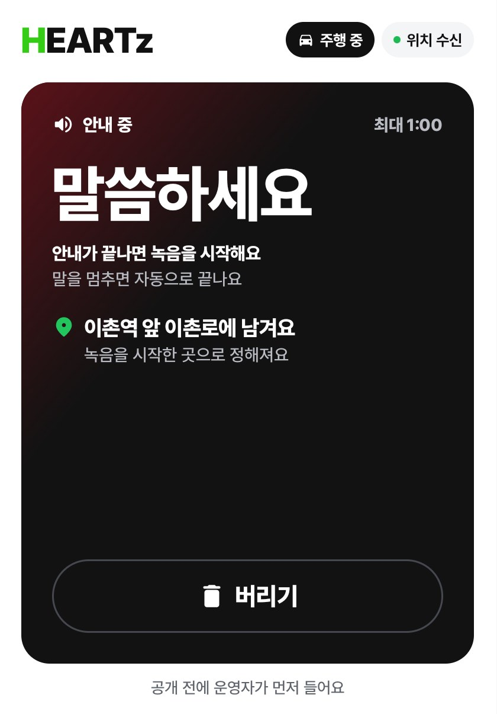 | 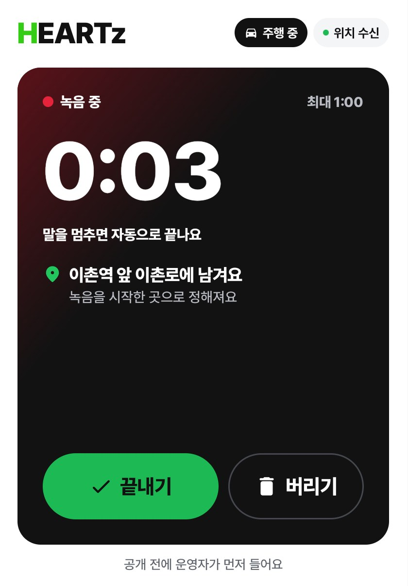 | 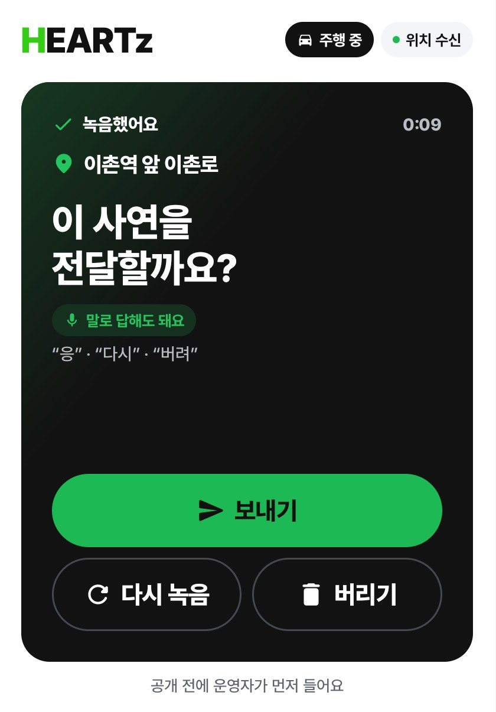 |

| 목소리 질문 | 검수에 보냄 | 말소리 없음 |
|---|---|---|
| 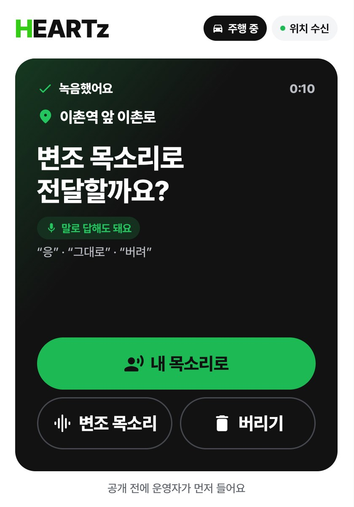 | 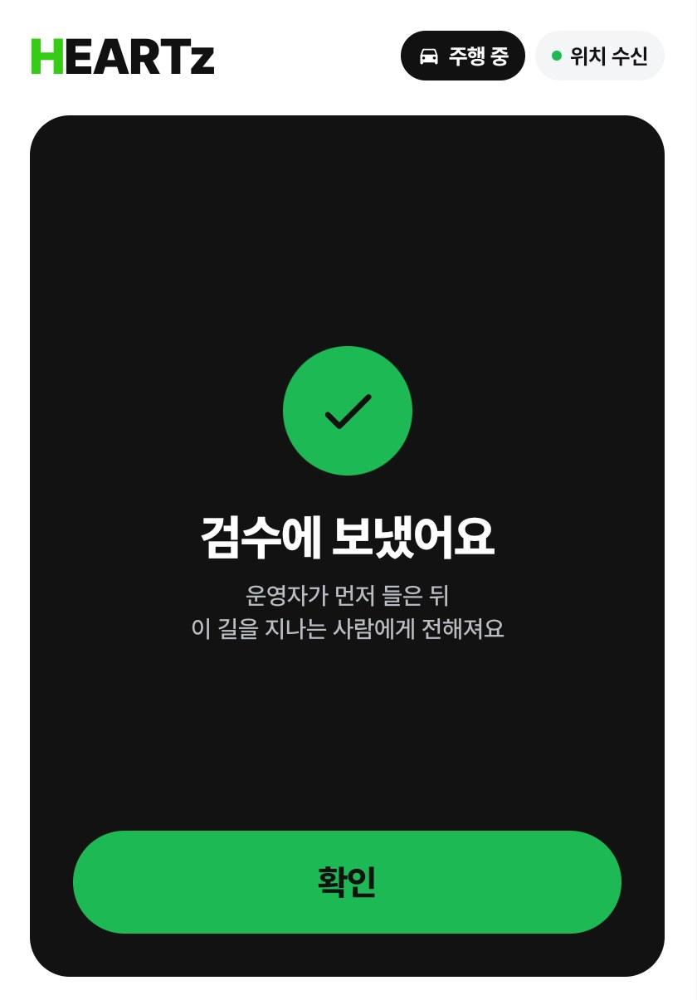 | 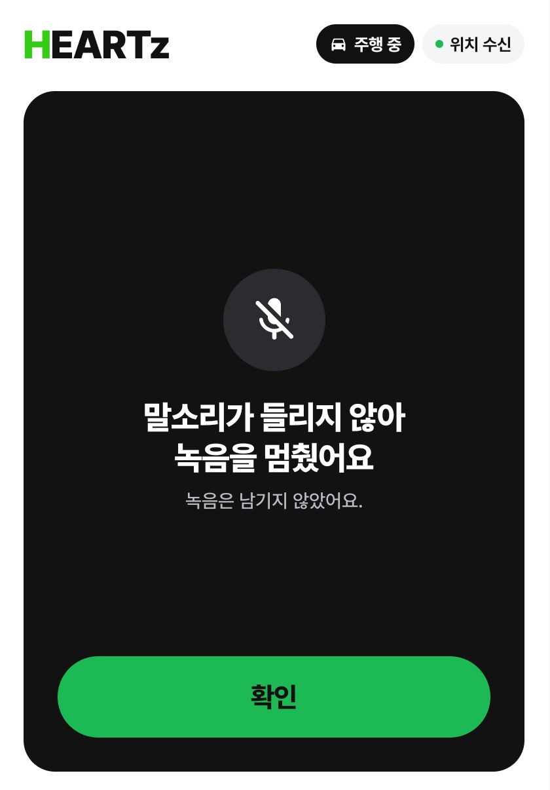 |

**목적:** 사연과 관련된 곳을 지나는 중에 손을 쓰지 않고 이야기를 남긴다.

**시작 조건:** 설정에서 켜져 있음(기본 켜짐), 마이크 권한 있음, 로그인 상태. 아니면 이유를 보여 주고 시작하지 않는다.

| 단계 | 입력 | 출력·결과 |
|---|---|---|
| ① 시작 | 큰 버튼 **지나면서 남기기** / Gleo "지금 지나는 곳에 사연 남길래" | **녹음을 시작한 위치로 장소를 고정.** 다른 소리를 잠시 멈춤. Gleo로 시작하면 Gleo 대답이 끝난 뒤 진행. 안내 "사연을 말해주세요." 안내 중에는 초록 마이크 원과 "안내가 끝나면 녹음을 시작해요" |
| ② 녹음 | 말하기 | 어두운 바탕에 남기기(주차) 녹음과 같은 구성: "● 녹음 중", "0:00 / 1:00", 빨간 정지 원("누르면 녹음을 멈춰요"), **버리기**. 오른쪽 위 칩은 반경 1 km 안 가장 가까운 랜드마크, 없으면 "위치 정보 없음". **말이 멈추고 3초 조용하면 자동 종료.** 마이크가 꺼지면 바로 전달 질문으로 넘어가고, 잡음 줄이기는 뒤에서 이어서 하며 보내기 전에 끝낸다. 처음부터 8초 동안 말이 없으면 "말소리가 들리지 않아 녹음을 멈췄어요"(남기지 않음). 최대 60초 |
| ② 끝내기 | 정지 원 / Gleo "녹음 끝내 줘" | 녹음 종료 → ③ |
| ③ 전달 질문 | 안내 "이 사연을 전달할까요? 다시 녹음하려면 '다시'라고 말해 주세요." → 말로 답 | "응/전달해 줘" → ④ / "변조 목소리로 보내 줘"처럼 목소리까지 말하면 ④ 건너뜀 / "다시" → ③-1 / "아니", "버려" → 버림 |
| ③-1 다시 녹음 | 말 "다시", "재녹음" / 버튼 **다시 녹음** / Gleo "다시 녹음할래" | 방금 녹음을 지우고 **같은 장소로** "사연을 다시 말해주세요." → ② (주행 중에도 가능) |
| ④ 목소리 질문 | 안내 "원하시면 변조 목소리로 사연을 전달할까요?" → 말로 답 | "응/변조로" → 변조 목소리 / "아니/그대로/내 목소리로" → 내 목소리. 모르면 한 번 더 묻고, 그래도 모르면 **내 목소리**. 앱이 낸 질문이 마이크로 되들어와 받아쓰인 것(질문 글과 거의 같은 말)은 답으로 쓰지 않고 다시 듣는다 |
| ③④ 화면 | — | 질문 제목과 버튼만. "말로 답해도 돼요"·예시 답변은 없다 |
| ③④ 버튼 | ③ **보내기 / 다시 녹음 / 버리기**, ④ **내 목소리 / 변조 목소리 / 버리기** | 말 대신 바로 정한다 |
| ③④ Gleo | "보내 줘", "변조 목소리로 보내 줘", "다시 녹음할래", "버려 줘" | 같은 결과. 결과는 Gleo가 말한다 |
| (못 알아들음) | — | ③은 한 번 더 묻고, 그래도 모르면 **보내지 않고 기기 초안으로 보관**: "답을 듣지 못해 초안으로 보관했어요. 주차 후 내 사연함에서 확인해 주세요." |
| ⑤ 결과 | — | 녹음은 보내기 전에 잡음을 줄인다. "사연을 보냈어요. 검수 후 공개돼요." / "변조 목소리로 보냈어요. 검수 후 공개돼요." / "사연을 버렸어요" / "지금은 보내지 못해 초안으로 남겼어요". 화면과 안내 음성, 6초 뒤 또는 확인으로 닫힘. 보낸 경우 화면은 "검수에 보냈어요"(또는 "변조 목소리로 검수에 보냈어요")와 **확인**만 있고 운영자 안내 문장은 없다 |
| 언제든 버리기 | 버튼 **버리기** / 말 "버려" / Gleo "버려 줘" | 진행 중이면 바로 버리고 "사연을 버렸어요". **이미 저장한 뒤에도 30분 안이면** 방금 남긴 사연을 지운다 |

| 끼어든 소리 | 동작 |
|---|---|
| 전화(수신·통화) | 녹음을 멈추고 **말없이** 기기 초안으로 보관 |
| Gleo 호출 | 녹음을 멈추고 Gleo 명령을 기다린다. 명령이 없으면 Gleo가 조용해진 뒤 ③ 질문 |
| 앱 화면이 닫힘 | 말없이 기기 초안으로 보관 |

- 2초보다 짧은 녹음은 남기지 않는다.
- 녹음을 시작한 곳이 등록된 장소 구간 밖이면 질문 없이 장소 없는 초안이 된다("장소를 찾지 못해 초안으로 보관했어요"). 주차 후 2-5에서 장소를 고른다.
- 서버로는 장소 ID만 보낸다. 원본 좌표는 보내지 않는다.

---

## 2. 주차 중 화면

### 2-0. 공통 틀

- **왼쪽 메뉴:** 지금 이 길 · 지나온 사연(안 들은 수) · 남기기 · 내 사연함 · 검수(운영자만) · 설정.
- **아래 미니 플레이어:** 사연 재생 중일 때만. 진행 막대, "OO에서 온 사연", 일시정지·재생, 그만(상태 문구 없음).
- **짧은 알림:** 저장·신고·숨김 결과를 아래에 잠깐 띄운다.

### 2-1. 지금 이 길

이 화면의 v8 캡처는 현재 목록에 없다. 사연 카드·대기 카드의 모양은 1-1을 따른다.

| 요소 | 입력 | 출력·결과 |
|---|---|---|
| 사연 카드 / 기다리는 중 | (차량 위치) | 1-1과 같은 카드(진행 막대 없음, 재생 상태는 아래 미니 플레이어). 주차 중에는 안내·자동 재생하지 않는다 |
| 안 들은 사연 N (또는 지나온 사연) | 터치 | 2-2 |
| 남기기 | 터치 | 2-4 |

### 2-2. 지나온 사연

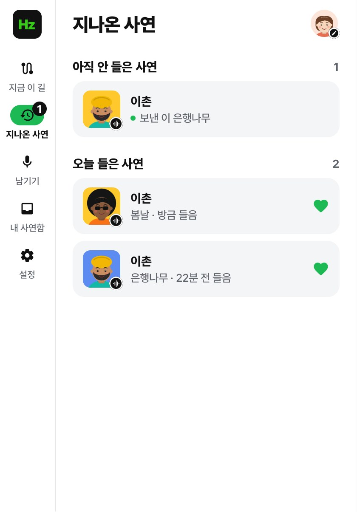

| 요소 | 입력 | 출력·결과 |
|---|---|---|
| 새 사연 목록 | 항목 터치 → 2-3 | 오늘 도착했지만 듣지 않은 사연. 사연 색 바탕의 프로필 얼굴과 작은 점 |
| 오늘 들은 사연 | 항목 터치 → 2-3 | 보낸 이 · 들은 시각, 하트를 남겼으면 하트 표시 |

### 2-3. 사연 상세

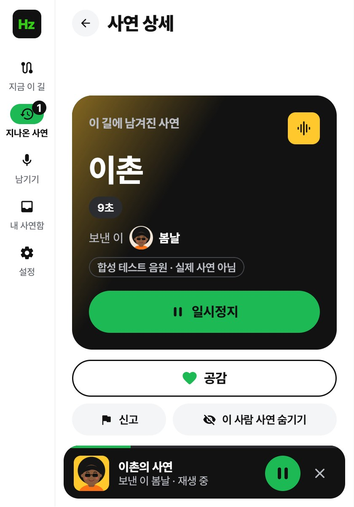

신고·숨기기·삭제 대화상자의 v8 캡처는 현재 목록에 없다.

사연지는 화면 가운데에 놓는다.

| 요소 | 입력 | 출력·결과 |
|---|---|---|
| 듣기 / 일시정지 | 터치 | 재생 / 멈춤 |
| 공감 | 터치 (다른 사람의 공개 사연) | 하트를 남기거나 거둔다. **글자·버튼은 그대로이고 하트 색만** 빈 하트 ↔ 분홍 하트로 바뀐다. 한 사람당 한 번. 작성자는 내 사연함에서 하트 수를 본다 |
| 신고 | 터치 → 사유: 장소와 관련 없음 · 개인정보 노출 · 괴롭힘·불쾌감 · 갑작스러운 큰 소리 · 장난·반복 음성 | 운영자 검수의 신고 목록에 올라감 |
| 이 사람 사연 숨기기 | 터치 → 확인 | 그 사람의 사연이 더 오지 않음(설정에서 되돌림) |
| (내 사연) 듣기 | 터치 | 고른 목소리로 듣는다. 변조 목소리인데 받아쓰기가 아직 없으면 원본을 틀지 않고 "변조 목소리를 아직 준비하는 중이에요. 잠시 뒤 다시 들어 주세요" |
| (내 사연) 목소리·버튼 한 줄 | 터치 | "내 목소리로 전해요"/"변조 목소리로 전해요" 한 줄과 같은 크기 버튼 두 개: 예전 데이터의 보내지 않은 사연이면 **검수에 보내기 / 삭제**, 그 밖에는 **상태(검수 중·공개·반려됨·숨김) / 삭제** |

음성 답장 버튼은 없다.

### 2-4. 남기기 (주차 중)

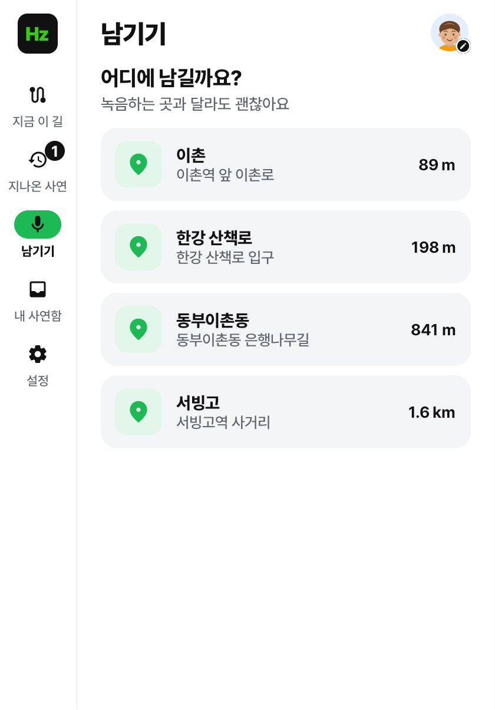

녹음·미리 듣기·완료 상태의 v8 캡처는 현재 목록에 없다.

②③④는 화면 가운데에 놓고, 경고("조금 더 길게 들려주세요")는 아래에 띄운다.

| 단계 | 입력 | 출력·결과 |
|---|---|---|
| ① 장소 | 검색창(장소 이름·구·동) / 장소 카드 터치 | 랜드마크 이름과 "구 동". 띄어 쓴 낱말이 모두 들어간 장소만 남기고 이름에 맞는 곳을 먼저 보여 준다. 없으면 "‘…’에 맞는 장소가 없어요". 녹음하는 곳과 달라도 된다 |
| ② 녹음 | 마이크 버튼(시작/멈춤), 뒤로 | "0:00 / 1:00", 최대 60초. 권한이 없으면 "마이크 허용". 멈추면 "목소리가 잘 들리게 잡음을 줄이는 중"(기기 안 처리, 실패하면 원본 그대로) |
| ③ 미리 듣기·다시 녹음 | 터치 | 잡음을 줄인 녹음을 듣는다. 다시 녹음하면 파일을 버리고 ②로 |
| ③ 어떤 목소리로 전할까요 | **내 목소리**(기본) / **변조 목소리** | 변조 목소리는 받아쓴 글을 안내 목소리로 읽어 준다 |
| ③ 보내기 | 터치 | 검수에 보낸다("보낸 사연은 검수 후 공개돼요") |
| ④ 완료 | 하나 더 / 내 사연함 보기 | "검수에 보냈어요" / "아직 보내지 못했어요"(초안으로 보관) |

### 2-5. 내 사연함

이 화면의 v8 캡처는 현재 목록에 없다. 나만 듣기는 제공하지 않는다.

| 요소 | 입력 | 출력·결과 |
|---|---|---|
| 남기기 | 터치 | 2-4 |
| 보내지 못한 사연 | 장소 고르기, 버리기 / 검수에 보내기 | 네트워크 실패·통화 중단·답 없음·장소 없음으로 남은 사연. 장소가 없으면 녹음을 시작한 곳에서 가까운 순으로 장소 버튼 |
| 남긴 사연 목록 | 항목 터치 → 2-3 | 남긴 시각, 받은 하트 수, 상태(작은 점 + 조용한 글씨) |

### 2-6. 검수 (운영자 계정)

| 공개 중 | 반려 사유 |
|---|---|
| 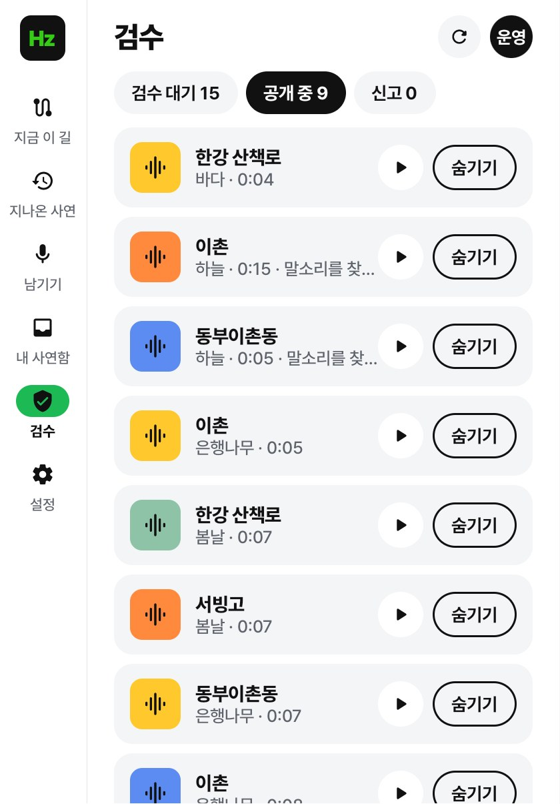 | 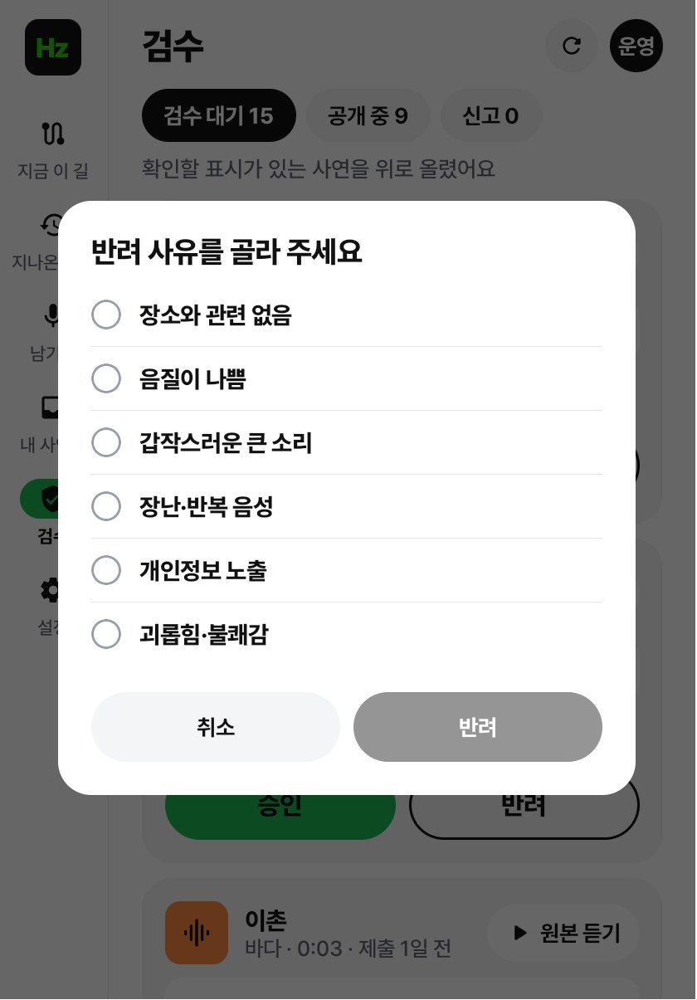 |

| 요소 | 입력 | 출력·결과 |
|---|---|---|
| 검수 대기 · 공개 중 · 신고 | 탭 | 목록과 건수 |
| 원본 듣기 | 재생 버튼 | 원본 음성(변조 목소리 사연도 원본). 받아쓰기는 말이 멈춘 곳마다 줄을 바꿔 전부 보여 준다. 변조 목소리 사연은 "변조 목소리(받아쓰기를 읽어 줌)" 표시. 받아쓰기가 없으면 승인할 수 없다 |
| 받아쓰기·확인 표시 | — | 전화번호·주소로 보이는 말, 반복, 큰 소리, 말소리 없음 등. 순서를 정하는 데만 쓰고 자동 승인·차단하지 않는다 |
| 승인 / 반려(사유) / 숨기기 | 터치 | 공개 중 / 반려 / 공개 목록에서 빠짐 |

### 2-7. 설정

이 화면의 v8 캡처는 현재 목록에 없다. 프로필 꾸미기 화면은 2-9에 있다.

| 요소 | 입력 | 출력·결과 |
|---|---|---|
| 계정 | 장클로드 · 김피티 · 상도동메시(테스트 운전자), 운영자(테스트) | 계정 전환. 실명 확인은 없다 |
| 사연이 오면 바로 읽어 주기 | 스위치(기본 켜짐) | 1-1의 도착 안내·자동 재생·공감 질문 여부 |
| 지나면서 남기기 | 스위치(기본 켜짐) | 1-1의 큰 버튼과 Gleo 녹음 시작 허용. 켤 때 마이크 권한 요청 |
| 권한 | (빠진 권한만) 위치 허용 / 마이크 허용 | 권한 요청 |
| 숨긴 사람 | 다시 보기 | 숨긴 사람이 있을 때만 |
| 데이터 | 동기화, 기기 안 / 개발 서버 | 마지막 동기화 시각·오류 |
| 정보 · 기술 진단 | 터치 | 버전, 샘플 음원 안내, 2-8 |

### 2-8. 기술 진단 (개발·시연용)

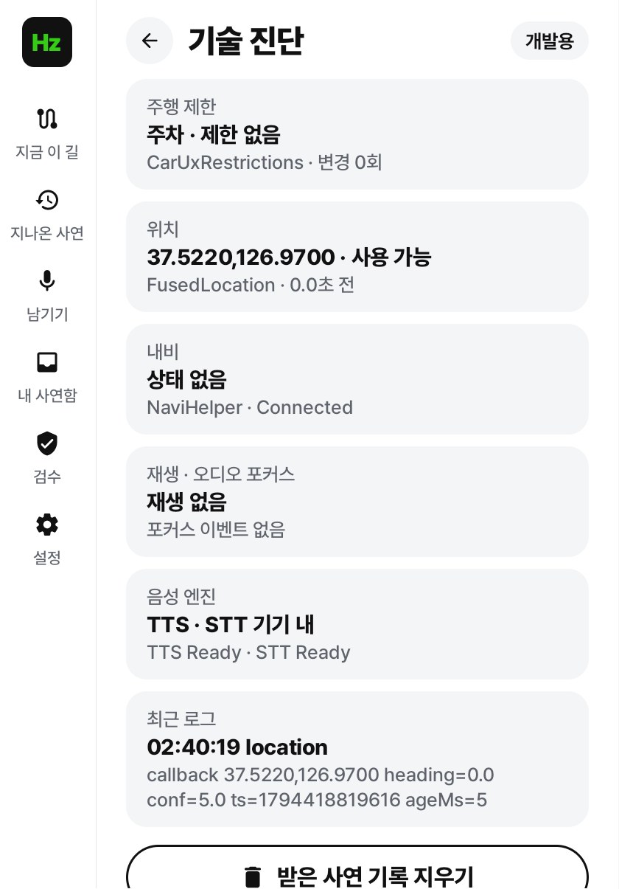

앱이 실제 SDK에서 받은 값(주행 제한, 위치, 내비, 재생·포커스, TTS·STT 상태, 최근 로그)을 확인한다. debug 빌드에는 **받은 사연 기록 지우기** 버튼이 있다(기기 안 데모 데이터에서 지금 계정의 받은·들은 기록만 지워 같은 사연을 다시 받아 볼 수 있음. 하트·숨긴 사람은 그대로).

### 2-9. 프로필 꾸미기 (5차 개정에서 삭제)

5차 개정에서 이 화면을 없앴다. 프로필은 닉네임 첫 글자 원이고, 화면 위 프로필을 누르면 설정으로 간다. 아래는 이전 기록이다.

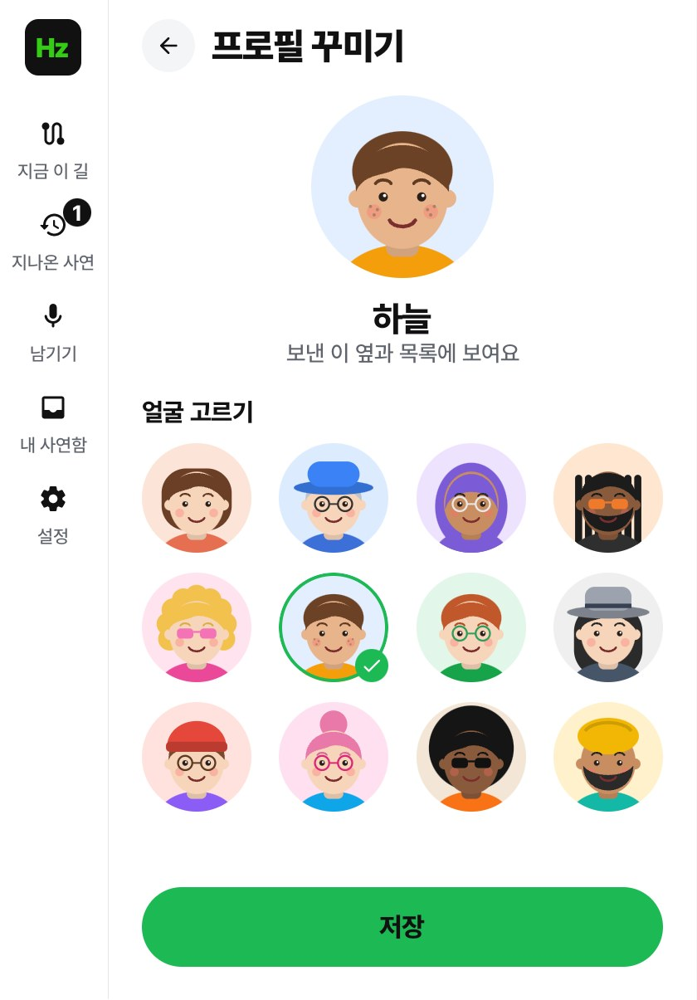

(이전) 현재 계정의 동물을 **쥐·소·호랑이·토끼·용·뱀·말·양·원숭이·닭·개·돼지** 중 고르고 닉네임과 함께 **저장**한다. 호랑이는 사용자 제공 원본이며 나머지 11종은 같은 연출의 3D 이미지로 생성했다([생성 기록](../assets/zodiac-prompts.md)). 저장하면 화면 위 프로필·설정·기존 사연의 보낸 이에도 최신 동물·닉네임이 반영된다. 뒤로 가면 저장하지 않은 선택은 적용하지 않는다. 기존 얼굴 번호는 같은 번호의 동물로 표시하며 초기화하지 않는다.

---

## 3. 화면 밖 기능

### 3-1. Gleo 음성 명령

`assets/schema.json`으로 Gleo에 함수 3개를 알린다(가이드 제한: 최대 3개, 설명·응답은 영어, 7초 안에 응답).

| 함수 | 파라미터 | 말 예시 | 앱 동작 | Gleo에 돌려주는 결과 |
|---|---|---|---|---|
| START_STORY_RECORDING | 없음 | "지금 지나는 곳에 사연 남길래" | 1-2 시작(Gleo 대답이 끝난 뒤 녹음) | success / fail(이유) |
| MANAGE_MY_STORY | decision: FINISH · SUBMIT · RERECORD · DISCARD, voice(선택): ORIGINAL · MODULATED | "녹음 끝내 줘", "보내 줘", "변조 목소리로 보내 줘", "다시 녹음할래", "버려 줘" | 끝내기 / 보내기(voice가 없으면 목소리를 묻는다) / 다시 녹음 / 버리기(진행 중 또는 방금 저장한 사연) | success / fail(정할 사연 없음) |
| HANDLE_ARRIVED_LETTER | choice: PLAY · SKIP · SEND_HEART · NO_HEART | "사연 읽어 줘", "넘겨", "하트 남겨 줘", "하트는 됐어" | 읽기(Gleo 대답이 끝난 뒤 재생) / 넘기기 / 하트(카드가 닫힌 뒤 10분 안이면 방금 들은 사연) / 하트 없이 닫기 | success("Your heart was delivered to the storyteller." 등) / fail(사연 없음 등) |

- 함수 이름 `HANDLE_ARRIVED_LETTER`는 실제 Gleo로 확인한 등록과 맞추려고 그대로 두고, Gleo가 읽는 설명·응답 문장은 "story"로 바꿨다. **바뀐 schema(0.4.0)는 실제 Gleo로 다시 확인하지 않았다.**

- **Gleo는 앱이 먼저 말을 걸게 하는 기능을 제공하지 않는다**(가이드에 없음). 그래서 도착 안내와 "공감 하트를 남길까요?", "전달할까요?" 같은 앱의 질문은 Pleos TTS로 말하고 Pleos STT로 듣는다. 운전자가 Gleo를 불러 말하면 위 함수로 같은 동작을 한다.
- Gleo로 정한 결과는 Gleo가 말하므로 앱은 같은 내용을 다시 말하지 않는다.
- "HEARTz 앱 열어 줘"처럼 앱 이름으로 여는 것은 아직 되지 않는다(Gleo 앱 이름 목록에 없음, 운영사무국 문의 대상).

### 3-2. 소리 정책 (오디오 포커스)

앱의 소리 요청은 하나의 포커스로 묶는다. 그래야 안내, 사연, 공감, 다음 사연 사이에 음악이 잠깐 튀어나오지 않는다.

| 상황 | 요청 | 결과 |
|---|---|---|
| 사연 도착 안내부터 공감을 정할 때까지 | 잠깐 멈춤(GAIN_TRANSIENT) | 음악이 멈춘다. 사연이 끝나도 공감 질문 동안 계속 멈춰 있고, 정한 2초 뒤 반납해 음악이 다시 나온다. 줄 선 사연이 있으면 반납하지 않고 이어 간다 |
| 공감 질문·고마움 안내 | 덕킹 허용(GAIN_TRANSIENT_MAY_DUCK)을 함께 요청 | 이미 멈춤 포커스를 들고 있어 음악은 멈춘 상태. **이 에뮬레이터는 HAL 덕킹이 꺼져 있다** |
| 변조 목소리 사연 읽기 | 잠깐 멈춤(GAIN_TRANSIENT) | 읽는 동안 음악이 멈춘다. 다른 소리가 끼어들면 문장 단위로 멈췄다가 이어 읽는다 |
| 원본 사연 재생 중 내비 안내 | — | 사연 소리를 30%로 줄였다가 안내가 끝나면 되돌린다 |
| 사연 재생 중 통화·Gleo | — | 사연을 잠시 멈췄다가 이어서 재생 |
| 지나면서 남기기 | 잠깐 독점(GAIN_TRANSIENT_EXCLUSIVE) | 안내·녹음·질문 동안 음악이 멈추고 끝나면 다시 나온다 |

참고: Gleo는 말하거나 들을 때 음악을 잠깐 멈추게 한다(GAIN_TRANSIENT, 에뮬레이터 로그).

### 3-3. 목소리

- 앱의 안내·질문은 Pleos TTS로 말하고, 목소리는 시스템의 Gleo 목소리 설정을 따른다(음성 엔진 로그: HEARTz의 TTS가 Gleo 앱 설정을 찾아 `haeun` 사용).
- 샘플 사연 6편(합성 테스트 음원)도 같은 Gleo 목소리로 다시 녹음했다. 사람이 남긴 사연은 기본으로 그 사람의 목소리 그대로(잡음만 줄임)이고, 작성자가 변조 목소리를 고르면 받아쓴 글을 같은 Gleo 목소리로 읽는다.

### 3-4. 시스템 미디어

"HEARTz 음성 사연"(팟캐스트) 아래 "지금 이 길의 사연", "오늘 지나친 사연" 트리를 제공하고(변조 목소리 사연은 음원이 없어 빠진다) 미디어 키로 재생·일시정지한다. 에뮬레이터 미디어 센터 화면에 실제로 보이는지는 확인하지 못했다(시스템 로그에 "미디어 템플릿 앱 아님"으로 건너뛴 기록).

### 3-5. 권한

| 권한 | 언제 요청 | 거부하면 |
|---|---|---|
| 차량 위치 | 처음 열 때, 설정 | 사연이 오지 않고 "위치 권한 필요" |
| 마이크 | 남기기 녹음, 지나면서 남기기를 켤 때 | 녹음·말로 답하기를 할 수 없음 |
| Pleos TTS·STT 서비스 | 앱에 선언(요청 화면 없음) | 안내 음성·질문 없이 버튼으로만 동작 |

---

## 4. 값 정리

| 항목 | 값 |
|---|---|
| 사연 상태 | 검수 중 → 공개 / 반려, 공개 → 숨김 (예전 데이터의 초안·나만 듣기는 "보내지 않음") |
| 목소리 | 내 목소리(기본) / 변조 목소리 |
| 화면 색 | 파랑·주황·노랑·초록 중 사연마다 하나(임의, 고정) |
| 프로필 | 닉네임 첫 글자 원(Pleos Connect 상태 표시줄 모양). 닉네임은 계정에 저장된 이름(Pleos 프로필 연동은 향후 개발) |
| 장소·도착 | 서울 25개 구 랜드마크 236곳, 반경 1 km 안이면 도착 |
| 녹음 길이 | 최대 60초, 최소 2초 |
| 자동 종료 | 말한 뒤 3초 조용 / 처음부터 8초 말 없음(버림) |
| 답 듣는 시간 | 공감 질문 6초, 남기기 질문 7초, 모르면 한 번 더 묻기(남기기) |
| 닫기까지 | 하트 여부 결정 뒤 5초(줄 선 사연이 있으면 바로), 넘기기 뒤 1.5초 |
| "이번에는" | 줄 선 사연, 또는 앞 사연을 닫고 10초 안에 온 사연 |
| 잡음 줄이기 | 80 Hz 저역 차단, 스펙트럼 차감(조용한 15% 구간을 잡음으로 추정), 음량 맞춤 |
| 저장 뒤 버리기 | 30분 안 |
| 음악 다시 재생 | 공감 여부를 정하고 2초 뒤 |
| 질문 전 내비 대기 | 최대 10초 |
| 내비 안내 중 사연 소리 | 30% |
| 공감 하트 | 다른 사람의 공개 사연에 한 사람당 1개 |
| 신고 사유 | 장소와 관련 없음, 개인정보 노출, 괴롭힘·불쾌감, 갑작스러운 큰 소리, 장난·반복 음성 |
| 반려 사유 | 장소와 관련 없음, 음질이 나쁨, 갑작스러운 큰 소리, 장난·반복 음성, 개인정보 노출, 괴롭힘·불쾌감 |

---

## 5. 확인 범위와 한계

- **테스트 입력:** 위치는 에뮬레이터 위치 입력, 기어는 Virtual Console. 실제 차량이 아니다.
- **말로 답하기:** 에뮬레이터에서 PC의 가상 입력 장치에 합성 음성("응, 읽어 줘" 등)을 넣어 실제 STT 경로로 확인했다. 사람 목소리·차량 마이크·주행 소음에서는 확인하지 않았다.
- **Gleo:** 사용자가 실제 목소리로 "편지 읽어 줘"를 말해(2차 개정 전 schema) `HANDLE_ARRIVED_LETTER`가 호출되고, Gleo 대답이 끝난 뒤 사연이 나오는 것을 확인했다(2026-11-10 23:54). 나머지 명령은 adb 모의 호출로만 확인했다.
- **음악·내비:** 시험 전용 음악 앱(캐논 D장조, Kevin MacLeod 연주, CC BY 3.0)과 실제 내비의 경로 안내 음성으로 확인했다. 덕킹은 이 에뮬레이터에서 확인할 수 없다.
- **2차 개정 확인(2026-11-11):** 에뮬레이터에서 도착 안내→바로 읽기, 읽는 중 다른 곳 도착→줄 세움→터치 공감→고마움 안내→"이번에는"→다음 사연 재생, 답 없음→음악 2초 뒤 반납·5초 뒤 닫힘, 변조 목소리 읽기(시험 글 3문장), 잡음 줄이기(합성 잡음, 잡음 바닥 약 −16 dB)를 확인했다. 지나면서 남기기의 다시 녹음·목소리 질문은 fake 단위 테스트로만 확인했다(실제 STT 미실행).
- **v8 확인(2026-11-12, 클로드 기록):** 840px 분할 창에서 주차 화면과 미니 플레이어, 주행 안내→재생→공감 질문→닫힘, 가상 마이크 시험 음성 녹음→터치 전달·목소리 선택→검수 전송, 무응답 초안, 얼굴 저장, 시스템 뒤로 가기를 확인했다. 이번 문서 정리에서 해당 동작을 다시 실행하지는 않았다.
- **추가 확인:** v8 UI의 말로 답하기(STT)·현재 schema의 실제 Gleo 호출, 전체 폭과 다양한 창 크기, Pretendard 파일이 없는 기기의 대체 글꼴, 실제 사람 목소리·주행 소음. 이전 시험 결과를 이 항목의 통과 근거로 쓰지 않는다.

## 6. v8 캡처 목록

클로드가 2026-11-12에 저장한 기존 캡처 17장이다. 이번 정리에서 새로 촬영한 화면은 없다.

| 구분 | 캡처 |
|---|---|
| 주행 | [대기](images-v8/d-waiting.jpg) · [재생](images-v8/d-playing.jpg) · [공감 질문](images-v8/d-heart-question.jpg) · [하트 없이 닫기](images-v8/d-no-heart.jpg) |
| 지나면서 남기기 | [안내](images-v8/r-guide.jpg) · [녹음](images-v8/r-recording.jpg) · [전달 질문](images-v8/r-ask-deliver.jpg) · [목소리 질문](images-v8/r-ask-voice.jpg) · [보냄](images-v8/r-sent.jpg) · [말소리 없음](images-v8/r-no-speech.jpg) |
| 주차 | [지나온 사연](images-v8/p-passed.jpg) · [상세·미니 플레이어](images-v8/p-detail-miniplayer.jpg) · [장소 선택](images-v8/p-compose-place.jpg) |
| 검수 | [공개 중](images-v8/p-moderation-public.jpg) · [반려 사유](images-v8/p-reject-dialog.jpg) |
| 설정 | [프로필 꾸미기](images-v8/p-profile.jpg) · [기술 진단](images-v8/p-diagnostics.jpg) |

## 7. 12간지·닉네임·시작 화면 캡처

2026-11-12 Pleos AVD에서 촬영했다. 아래 컴포넌트 캡처의 닉네임·카드는 자동 UI 시험 데이터로 실제 SDK 사연 도착 증거가 아니다. [실제 앱 최초 설정 화면](images-zodiac/first-profile-live.png)은 P 상태의 내비 옆 분할 창이다. 이미지 원본은 자르거나 보정하지 않았다.

| 시작 화면 | 동물·닉네임 설정 |
|---|---|
|  | 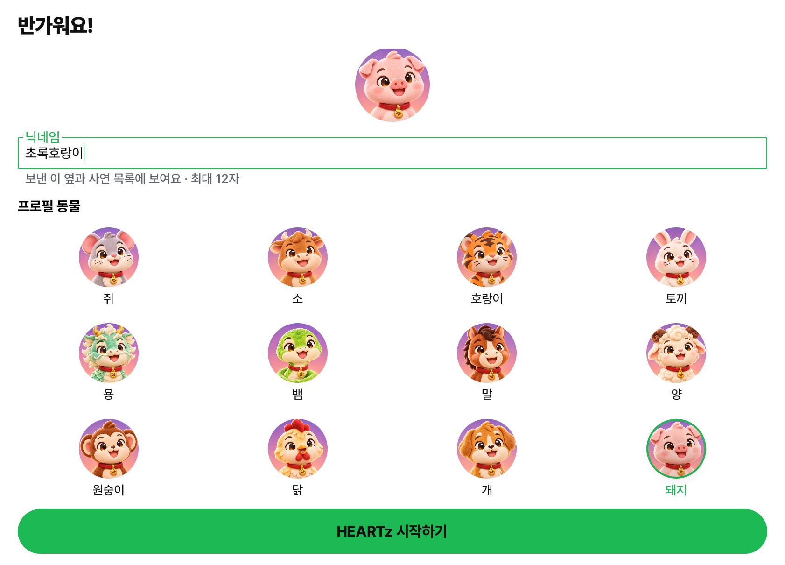 |

| 사연 정보 네 가지 | 메뉴 Hz·런처 아이콘 |
|---|---|
|  |  |
